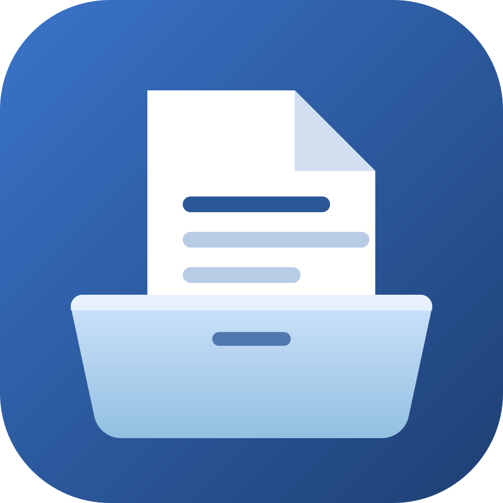

# Rechnungskiste

**Rechnungen schreiben. E-Rechnung automatisch. Alle Daten bleiben bei Ihnen.**

---

## Warum Rechnungskiste?

|  |  |
|---|---|
| **Extrem einfache Rechnungen** | In drei Schritten zur fertigen Rechnung: Für wen? Wofür? Fertig. Kein Fachwissen nötig. |
| **E-Rechnung ohne XML-Kenntnisse** | Für Firmenkunden legt das Programm die E-Rechnung (XRechnung) automatisch neben das PDF und lässt sie vom offiziellen KoSIT-Prüfer kontrollieren. |
| **Alles lokal** | Ihre Rechnungen und Kundendaten liegen als normale Dateien auf Ihrem Computer. Kein Konto, keine Cloud. |

## Das kann das Programm

- Rechnungen als PDF, bei Firmenkunden mit E-Rechnung (XML) daneben
- Eigener Steuersatz pro Leistung: 19 %, 7 % oder 0 %, auch gemischt auf einer Rechnung
- Kunden und Leistungen speichern und per Suche wiederfinden
- Ordner mit Sortierung nach Jahr, Rechnungen bearbeiten, kopieren, verschieben, löschen
- Rechnung nachträglich direkt im Dokument ändern
- Automatische Buchführung für ausgegangene Rechnungen als Excel-taugliche Datei
- Zufällige Rechnungsnummern, damit keine Nummer doppelt vorkommt
- Läuft ohne Internet

## Installation

1. Laden Sie unter [**Releases**](../../releases/latest) die Datei `Rechnungskiste Setup x.y.z.exe` herunter.
2. Starten Sie die Datei und folgen Sie dem Assistenten.
3. Beim ersten Start tragen Sie Ihre Firmendaten ein. Danach können Sie sofort Rechnungen schreiben.

> **Hinweis zu Windows:** Windows zeigt beim ersten Start eventuell „Der Computer wurde durch Windows geschützt".
> Klicken Sie auf **Weitere Informationen** und dann auf **Trotzdem ausführen**. Das Programm ist noch nicht signiert.

## Preise

| | Kostenlos | Vollversion |
|---|---|---|
| Preis | 0 € | 44 € pro Jahr |
| Rechnungen | 3 pro Monat | unbegrenzt |
| PDF und E-Rechnung | ✓ | ✓ |
| Updates | | ✓ im Lizenzjahr |
| Widerruf | | 14 Tage, Geld zurück |

Alle Preise zzgl. gesetzlicher MwSt.

## Häufige Fragen

**Wo liegen meine Rechnungen?**
Im Ordner `Dokumente\Rechnungskiste` auf Ihrem Computer. Den Speicherort können Sie im Programm ändern.

**Brauche ich ein Konto?**
Nein. Das Programm läuft ohne Anmeldung und ohne Cloud.

**Was ist die E-Rechnung?**
Für Firmenkunden speichert das Programm neben dem PDF eine XML-Datei im Standard XRechnung. Buchhaltungsprogramme lesen sie automatisch ein. Hängen Sie beim Versand an Firmenkunden beide Dateien an.

**Ist die E-Rechnung geprüft?**
Das Programm prüft jede E-Rechnung nach dem Speichern mit dem offiziellen KoSIT-Prüfer und zeigt Ihnen das Ergebnis. Bitte schauen Sie bei Ihrer ersten Rechnung genau hin. Das Programm ersetzt keine Steuerberatung.

**Wie kündige ich oder widerrufe ich?**
Schreiben Sie uns über „Hilfe" im Programm oder per E-Mail. Innerhalb von 14 Tagen nach dem Kauf erhalten Sie Ihr Geld zurück.

## Hilfe und Kontakt

Im Programm finden Sie unter **Hilfe** ein Kontaktformular. Sie erreichen uns auch per E-Mail:
[rechnungskiste.help@outlook.de](mailto:rechnungskiste.help@outlook.de)

Auf Wunsch richten wir die Rechnungskiste gemeinsam mit Ihnen per Telefon ein, einmalig für 13,99 €.

---

Rechnungskiste ist kein Steuerberatungs- oder Buchhaltungsprogramm. Bitte lassen Sie wichtige Fragen von Ihrer Steuerberatung klären.

